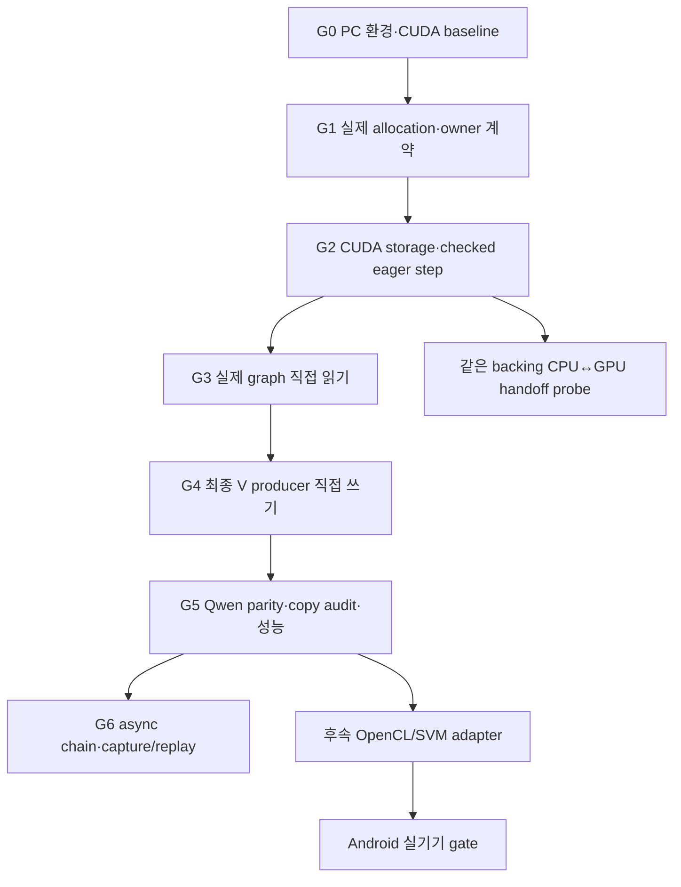

# GPU KV 확장 구현 계획 — WSL CUDA부터 (2026-10-29)

> 구현 전 계획·분석 기록이다. 후속 실제 결과는 [CUDA 실행 기록](gpu-cuda-execution.md)과 [최신 인계](gpu-handoff-2026-10-29.md)를 참고한다.

상태: **계획만 작성. 아래 신규 API·파일·target은 제안이며 아직 구현되지 않았다.**
기준 SHA와 소스 근거는 [분석 문서](gpu-extension-analysis.md),
재개 위치는 [GPU 인계](gpu-handoff-2026-10-29.md)를 참조한다.

사용자 조건에 따라 현재 PC의 RTX 5070을 WSL에서 먼저 검증한다.
Android 기기, Android 모델, NDK, QNN SDK를 첫 단계의 선행 조건으로 두지 않는다.

## 1. 최초 지원 범위와 완료 기준

최초 profile은 CUDA / FP16 activation·KV / token-major contiguous /
batch 1 / session 1 / step 1개 / inference / eager graph다.
synthetic Qwen형 graph에서 시작하고 이후 공개 Qwen3-0.6B로 확장한다.
FP32 core와 현행 CPU FP16-bit/UINT16 동작은 회귀 범위다.

| gate | 증명할 것 | 완료에 필요한 증거 |
|---|---|---|
| A: 직접 읽기 | attention이 core manager 소유 K/V history를 읽음 | backing id·범위 일치, KV mirror/history upload 0 |
| B: 직접 쓰기 | 최종 K/V producer가 write slice에 결과를 씀 | K RoPE destination, V FC destination 일치; append copy 0 |
| C: CPU↔GPU 공유 | 호환 layout/encoding의 동일 backing을 순차 사용 | 양방향 pattern/연산 결과, 주소/owner/offset, 완료·접근 규칙 |
| correctness | 경계·여러 step에서도 올바른 결과 | synthetic reference, 실제 wrapper, 모델 parity |
| lifecycle | queued work보다 allocation이 오래 살아 있음 | 지연 완료, 예외·reset·재할당·파괴 실패 주입 |

A를 통과한 중간 버전에는 V append copy가 남을 수 있다.
그 버전을 GPU A+B 완료로 표시하지 않는다.
device KV의 CPU 접근은 staging이므로 C의 완료로 계산하지 않는다.
C의 작은 handoff probe와 실제 모델 backend 전환은 별도 수준으로 보고한다.

초기 strict profile에서 ring, OHWI/image mirror, INT8 KV, training, batch>1,
다중 session, CUDA capture/replay는 명시적 unsupported다.
기존 compatibility 실행과 지원되지 않는 새 profile의 거절을 구분한다.
Gemma alias/hybrid producer 및 다른 backend의 기존 기능은 회귀 범위로 유지한다.

## 2. 의존 순서



H는 G2 이후 실제 CUDA allocation으로 실행한다.
공통 계약은 device-specific header가 없는 core에 두고,
CUDA/OpenCL allocation·동기화는 해당 backend 쪽에서 구현한다.

## 3. G0 — 다음 세션의 환경 준비와 변경 전 baseline

**제품 코드보다 먼저** Toolkit 및 현재 CUDA 경로의 실행 가능성을 확인한다.

1. 기준 SHA·git status·compiler·Meson options·driver를 manifest로 남긴다.
   기존 `build/`는 다른 branch의 결과이므로 재사용하지 않는다.
2. RTX 5070의 device ordinal/UUID, cc, managedMemory,
   concurrentManagedAccess, canMapHostMemory, unifiedAddressing,
   hostNativeAtomicSupported 등 필요한 속성을 조회한다.
   값은 실제 query로 결정하고 WDDM 일반론으로 채우지 않는다.
3. WSL용 Linux CUDA Toolkit을 준비한다.
   cudart/NVRTC/builtins/cuBLAS/cuBLASLt와 headers·driver library 해석을 확인한다.
   WSL의 Windows driver 노출을 보존하는 driver-free Toolkit 설치를 사용한다.
4. 설치 NVRTC의 supported architecture와 `sm_120` compile/module load를 확인한다.
   본 저장소는 runtime NVRTC compilation을 사용한다.
   `nvcc --version` 또는 `nvidia-smi` 성공만으로 대신하지 않는다.
5. clang-format 14를 준비한다. CPU 공통 dependencies와 submodule 상태를 확인한다.
   tokenizer archive가 현재 libstdc++와 호환되지 않으면 별도 output에 재빌드하고,
   그때 Rust/Cargo와 tokenizer build 의존성을 추가한다.
6. 단순 GPU pattern 실행 및 기존 CUDA kernel tests를 먼저 통과시킨다.
   모델은 이 단계에서 필요하지 않다.

Toolkit 설치 시점에 [WSL guide](https://docs.nvidia.com/cuda/wsl-user-guide/index.html)와
[Linux 설치/지원 조합](https://docs.nvidia.com/cuda/cuda-installation-guide-linux/index.html)을
확인해 OS/compiler/driver와 맞는 버전을 고정한다.
현재 환경에 패키지나 모델을 설치한 상태로 기록하지 않는다.

### 빌드 구성 예시 — 준비 후 실행할 명령

`KV_CUDA_ROOT`는 준비한 Toolkit의 실제 절대 경로,
`KV_TOKENIZER_LIB`는 검증한 Linux tokenizer archive 절대 경로다.
compiler도 준비한 조합의 `CC/CXX`를 명시한다.

```bash
cd /home/jayden/nntrainer
git status --short
git rev-parse HEAD

meson setup build-kv-gpu-cuda-baseline --buildtype=debugoptimized \
  -Dplatform=none -Denable-app=true -Denable-transformer=true \
  -Denable-test=true -Denable-api=false -Denable-fp16=true \
  -Denable-cuda=true -Dcuda-path="$KV_CUDA_ROOT" -Denable-opencl=false \
  -Denable-npu=false -Denable-htp=false \
  -Denable-tflite-interpreter=false -Denable-tflite-backbone=false \
  -Denable-nnstreamer-backbone=false -Dml-api-support=disabled \
  -Denable-capi=disabled -Denable-nnstreamer-tensor-filter=disabled \
  -Denable-nnstreamer-tensor-trainer=disabled -Dopenblas-num-threads=1 \
  -Dcausallm-tokenizer-lib="$KV_TOKENIZER_LIB"

ninja -C build-kv-gpu-cuda-baseline -j 8
meson test -C build-kv-gpu-cuda-baseline --list
```

위 명령은 다음 세션용 구성 예시이며 실행하지 않았다.
처음에는 CUDA-only로 검증하고 OpenCL과의 통합 build는 이후 회귀에 추가한다.

기존 등록 target 중 `unittest_cuda_kernels_layernorm`,
`unittest_cuda_kernels_gelu`, `unittest_cuda_kernels_fc_qs4cx`를 먼저 확인한다.
테스트 내부의 SKIP/실제 실행 여부와 선택 engine을 함께 기록한다.
baseline이 실패하면 adapter 변경과 환경/기존 kernel 문제를 분리한 뒤 진행한다.

G0의 기존 kernel baseline은 아래처럼 새 프로세스에서 실행한다.
모든 flag와 실제 실행/skip 수를 결과에 기록한다.

```bash
NNTR_ENGINE=cuda \
NNTR_CUDA_DECODE_GRAPH=0 NNTR_CUDA_GRAPH=0 NNTR_CUDA_M2B=0 \
NNTR_CUDA_PREFILL_GRAPH=0 NNTR_CUDA_ASYNC=0 \
meson test -C build-kv-gpu-cuda-baseline --print-errorlogs \
  unittest_cuda_kernels_layernorm unittest_cuda_kernels_gelu \
  unittest_cuda_kernels_fc_qs4cx
```

실제 graph baseline/candidate에도 capture와 async를 같은 값으로 명시하고
device KV/attention/RoPE profile을 맞춘다.
INT8/OHWI 등 presence로 검사하는 비지원 flag는 `=0` 대신 unset한다.
runtime/env를 static으로 읽는 기존 코드가 있으므로 profile별로 프로세스를 분리한다.
G2의 strict admission도 지원하지 않는 capture/profile을 실행 전에 거절해야 한다.

`unittest_cuda_gemma4`는 존재하지만 build_by_default=false이고
현재 해당 블록에 Meson test 등록이 없다.
필요 시 target을 명시적으로 build하고 fixture와 함께 직접 실행해야 한다.
또한 broad `unittest_causallm_models`는 FP16 구성에서 생성되지 않으므로,
그 이름을 GPU FP16 모델 검증 명령으로 그대로 사용하지 않는다.

## 4. G1 — 실제 allocation 결과와 backend 독립 ownership

### 제안하는 계약

기존 MemAllocator/pool 기반을 확장하되 새 전역 allocator를 만들지 않는다.

| 정보/동작 | 필요한 내용 |
|---|---|
| allocation descriptor | actual kind, host/device 접근 영역, base/range, alignment, backend/device/context identity |
| ownership | 실제 release 함수, allocator/context lease, pool 또는 native backing owner |
| storage view | buffer id, generation, byte offset/size, encoding/layout, 허용 접근 영역 |
| host access | host가 실제 접근 가능한 시점과 범위를 제한하는 scoped access |
| completion | backend-neutral wait/status/lifetime 인터페이스; native event는 backend 내부 |
| 초기화/I/O | host memset 또는 device memset, snapshot read/write를 backend가 수행 |

kind 후보는 Host, CudaDevice, CudaManaged, CudaHostMapped,
OpenClSvmCoarse, OpenClSvmFine 등이다. 아직 enum/API는 없다.
요청 종류와 반환된 실제 종류를 둘 다 기록한다.
descriptor가 없는 device allocator는 Unknown으로 취급하고 strict profile에서 거절한다.

권고 구현 방향은 allocation별 query/result를 추가하고
MemoryPool의 metadata 생성도 그 결과를 사용하게 하는 것이다.
기존 virtual/installed API에 영향을 주면 clean rebuild와 ABI 영향을 명시한다.
MemoryData의 private setter를 무조건 public으로 열지 않는다.
owner를 유지하는 내부 bridge/factory 또는 pool bridge로 metadata를 전달한다.

### 파일 범위와 검증

- 공통: `nntrainer/kv_cache/kv_storage.*`, `kv_cache_manager.*`;
  필요 시 `kv_allocation.h`, `kv_completion.h` 같은 내부 header 추가.
- 기존 연결: `nntrainer/mem_allocator.*`, `nntrainer/tensor/memory_pool.cpp`,
  `memory_data.h`의 제한된 metadata bridge.
- CUDA 구현: `cuda_mem_allocator.*`와 `nntrainer/cuda/`.
- core header에 cuda_runtime/OpenCL/Linux 전용 header를 노출하지 않는다.

fake allocator/completion으로 overflow·alignment·host fallback·잘못된 kind·
owner 수명·generation·실패한 초기화·지연 완료를 검증한다.
CPU-only build에서도 이 계약 테스트가 실행되어야 한다.
ASan/UBSan은 portable 수명/범위 테스트에 적용하고 실제 GPU 검증과 구별한다.

완료: storage가 실제 backing을 설명하고, host/device fallback을 잘못 표시하지 않으며,
마지막 Tensor/view와 in-flight 작업이 끝나기 전 backing이 해제되지 않는다.

## 5. G2 — CUDA storage와 동기식 eager step

처음에는 **CUDA device KV**를 strict profile로 구현한다.
별도 host-mapped profile은 H에서 검증하고 managed는 query/probe 후 채택한다.

- host memset을 backend 초기화로 교체한다.
- device view는 native device address/range를 제공하고 host dereference를 허용하지 않는다.
- core initialize에 backend storage 생성 경로를 추가하되 CPU default는 유지한다.
- facade의 usesCpuStorage에 묶인 선택을 managed-core 여부/backend로 일반화한다.
- wrapper의 begin/bind/commit을 CUDA 경로에도 연결한다.
- GPU launch에 owner와 context/stream lease를 유지한다.
- 첫 버전은 producer 완료를 확인한 뒤 ready를 표시하고,
  consumer/graph 완료를 확인한 뒤 commit한다.
- `maybeFinish()`처럼 async/capture 설정에 따라 no-op이 되는 함수로
  완료 보장을 대신하지 않는다. checked wait와 실행 오류를 전파한다.
- 예외/abort에서도 이미 제출된 작업을 정리한 뒤 storage를 재사용·해제한다.
  destructor는 throw하지 않으며 device 오류 시 session을 invalid로 둔다.

현재 bool ready의 의미를 "enqueue했다"로 조용히 바꾸지 않는다.
최초의 보수적 wait 비용은 별도 기록한다.
G5 이후 필요한 경우 completion dependency를 가진 device read API로 확장하여
동일 stream의 중간 wait를 줄이고 commit 경계에서 완료를 보장한다.

완료: 모델 없이 nonzero offset의 K/V write/read, capacity 경계, guard bytes,
reset/reinit/destroy/누락 producer/지연 실패가 실제 GPU와 fake backend에서 통과한다.

## 6. G3 — 실제 wrapper와 MHA 직접 읽기

실제 tiny Qwen형 graph를 생성하는 FP16 GPU 전용 target을 추가한다
(제안 이름: `unittest_kv_cache_cuda_graph`; 현재 없음).
다운로드 fixture 없이 작은 deterministic weight를 생성한다.

1. 실제 CausalLM wrapper → graph → MHA를 실행한다.
2. K RoPE가 manager의 checked write slice에 쓰도록 연결한다.
3. 초기 V compatibility copy는 계측하고 허용 범위를 표시한다.
4. attention이 manager history를 읽는지 buffer id/range와 실제 dispatch에서 확인한다.
5. `mirror_kv`, host attention fallback, H2D history copy를 strict path에서 거절한다.
6. geometry/dtype/kernel 지원 조건을 실행 전에 대조하고 실패 이유를 반환한다.
7. prefill 1·2·여러 row, from>0 resumed prefill, decode, 여러 turn,
   capacity 끝·초과, repeated reset을 검증한다.

`producerReady`는 실제 K/V 완료 뒤에만 호출한다.
attention consumer의 완료도 commit/lifetime의 일부다.
MHA 내부 raw pointer 일치 검사만으로 kernel dispatch의 성공을 추론하지 않는다.

완료: A 통과, K 직접 쓰기 확인, V append bytes를 명시한 중간 단계.
이 단계에서 새 기본 실행 경로로 전환하지 않는다.

## 7. G4 — V 최종 producer 출력 binding

Qwen형의 bias 없는 `wv` FC / FP16 / batch 1 / 단일 V consumer를 최초 지원한다.
모델 또는 graph가 producer 역할을 명시적으로 선언하고,
core는 layer 이름이나 모델 종류를 해석하지 않는다.

권고 방향은 step에 종속된 외부 output binding이다.
graph planner에서 대상 output을 unmanaged destination으로 계획하고,
step 시작 전에 유효한 write slice와 active row 범위를 bind한다.
구체 API는 graph/RunLayerContext/TensorPool 계약 검토 후 확정한다.

- FC output과 MHA V input dependent가 같은 MemoryData와 offset을 보도록 연결한다.
- activation pool의 기존 buffer 재사용·cl_mem/기타 plane metadata를 남기지 않는다.
- backend ops 및 dtype이 바뀌지 않게 하고 nonzero destination offset을 처리한다.
- prefix와 step 범위 밖 guard가 보존되는지 검증한다.
- V가 이미 올바른 destination에서 생성된 경우 MHA append copy를 생략한다.
- 별도 `scalar_mul(...,1)`, D2D copy, staging buffer를 만들어 B를 대체하지 않는다.
- graph 예외와 다음 step에서 binding을 폐기/교체하고 stale destination을 거절한다.
- 다른 final producer(v_norm/epilogue 등)는 별도 capability가 있어야 지원한다.

완료: 실제 FC→MHA graph에서 A+B, append/history/mirror bytes 모두 0.
단순 mock에서 같은 포인터를 넣은 결과만으로 완료하지 않는다.

## 8. H — CPU↔GPU 동일 backing handoff

device KV와 별도로 host-mapped pinned allocation의 작은 profile을 검증한다.

- host/device alias와 UVA 동일 주소 여부를 조회하고 descriptor에 기록한다.
- CPU pattern 쓰기 → GPU 검증/변경 → 완료 wait → CPU 검증을 반복한다.
- CPU 접근과 GPU 접근을 겹치지 않고 ownership handoff를 명시한다.
- view offset·인접 영역·여러 Tensor alias·지연 완료·수명 테스트를 포함한다.
- 큰 pinned allocation, allocation 실패 및 managed/host fallback을 구별한다.
- 같은 backing에서 실제 CPU/GPU 연산이 가능한 encoding/layout을 명시한다.

완료 결과는 "pattern handoff", "작은 attention 전환", "실제 모델 전환"으로 구분한다.
최초 목표는 앞의 작은 실험이며, CPU↔CUDA 전체 모델 runtime 전환을 구현했다고
주장하지 않는다. WSL managed memory는 별도 attribute/coherence 실험 후 지원한다.

## 9. G5 — 모델, copy audit, 성능

모델이 없는 동안 G1–G4의 synthetic 검증을 먼저 진행할 수 있다.
실제 모델 gate는 준비가 끝난 뒤 열린다.

- Qwen3-0.6B revision, config/tokenizer/weights hash와 GPU 변환 profile을 고정한다.
- 기존 CPU ARM-packed weight를 GPU용으로 그대로 사용하지 않는다.
  x86/GPU weight layout과 converter 순서를 확인한다.
- baseline도 이번 PC에서 동일 CUDA arithmetic/kernel/profile로 측정한다.
- legacy CUDA와 새 manager를 비교하여 manager 변경의 정확성 영향을 분리한다.
- FP32 reference에는 수치 오차 기준을 미리 정하고 finite logits, 전체 logits,
  greedy token, continuation을 확인한다. CPU/GPU bitwise 일치를 기본 요구로 삼지 않는다.
- 동일 GPU 경로 baseline/candidate의 bitwise 또는 수치 차이는 별도로 기록한다.
- prefill 단일 block과 chunked, resumed prefill, decode, save/load continuation,
  capacity 경계·반복 session을 검증한다.

copy audit은 적어도 append-copy, history-copy, mirror-sync, layout-conversion,
snapshot-I/O, 정상 model input/output 전송을 구별한다.
API memcpy만 세지 말고 identity/scatter kernel도 계측한다.
주장 범위의 steady-state KV에서 append/history/mirror bytes가 0이어야 A+B를 통과한다.

성능은 load/JIT/weight packing/최초 allocation을 steady-state와 분리한다.
context 1K/4K, chunk 설정, decode 수, thread 수, GPU clock/온도,
다른 GPU 작업, VRAM/pinned 사용량을 기록한다.
동일 조건 paired 반복으로 median/p95를 비교하고 우선 기존 5% 회귀 예산을 사용한다.
변동이 크면 결론을 보류하고 같은 조건으로 재측정한다.

## 10. G6 및 OpenCL 후속

A+B eager 경로가 통과한 뒤 async chain과 capture/replay를 별도 변경으로 진행한다.

- queued producer와 완료된 producer를 API에서 구별하고 event dependency를 전달한다.
- capture는 storage identity/generation/context/geometry를 고정한다.
- replay마다 step 예약·성공/실패·position publish를 host wrapper에서 수행한다.
- base+device position을 이용한 V producer destination이 replay마다 올바르게 이동해야 한다.
- reset/load/setPosition/reallocate/destroy 시 capture를 invalidate하고 queued work를 정리한다.
- kernel regime 전환, threshold 경계, 여러 turn, 실패 후 재시작을 검증한다.

OpenCL은 G1 계약 위에 SVM adapter를 추가한다.
WSL에서 실제 OpenCL GPU가 조회될 경우 PC에서 먼저 probe하고,
현재 확보되지 않은 Android 실기기 gate는 이후 수행한다.
coarse/fine allocation flags·map/unmap·host fallback·context/queue identity를 검증한 뒤
buffer attention, 직접 producer, OHWI/image 순서로 진행한다.
CUDA 통과 결과가 Adreno/OpenCL 통과를 대신하지 않는다.

## 11. 변경 묶음과 기록

| 제안 commit 주제 | 주요 변경 | 필수 검증 |
|---|---|---|
| allocation 결과/owner | 공통 metadata, CUDA allocator, pool bridge | portable core + CPU 회귀 |
| CUDA storage/step | backend 초기화·I/O·완료·facade | synthetic GPU/lifetime/실패 |
| 실제 graph 직접 읽기 | wrapper/MHA + trace | A, prefix·경계·반복 |
| producer destination | planner/output binding, Qwen형 V | 실제 graph A+B, copy audit |
| 모델/성능 검증 | GPU harness와 재현 문서 | Qwen parity·snapshot·paired 성능 |
| async/replay | dependency/capture integration | eager parity + replay 경계 |

모든 C/C++ 변경은 clang-format 14, Doxygen, 해당 build/test 및 check_count 영향을 확인한다.
commit 시 `[component]`, 인간 identity/DCO sign-off,
`Co-authored-by: Codex (OpenAI)` 정책을 따른다.
새 source 등록은 root Meson, CausalLM app_build 및 Android/jni 경로의 영향을 함께 검토한다.
vendored `subprojects/` 파일을 편집하지 않는다.

결과는 ignored `build-kv-gpu-*/validation/` 등에 source/runtime/toolkit/device/model hash,
options와 실제 env, test XML, skipped 수, copy report, timing을 묶어 남긴다.
실행하지 않은 항목은 unverified/skipped로 남기고,
기존 CPU/Android artifact 경로를 현재 PC의 검증 자료로 인용하지 않는다.
